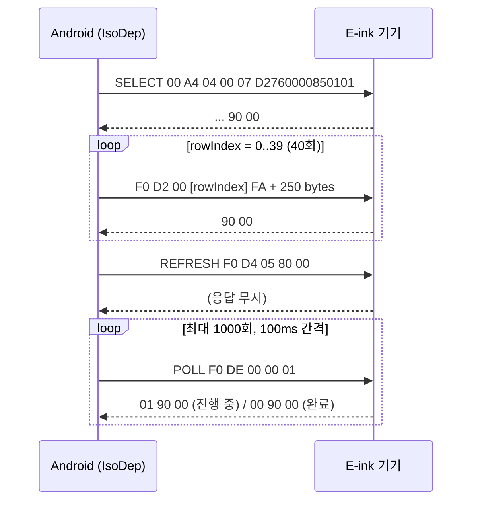

# EDEP NFC 전송 프로토콜 (레거시 앱 코드에서 추출)

- 출처: [digitaltok-android](https://github.com/DigitalTok/digitaltok-android) (`develop` 브랜치)
- 구현 위치: `ui/upload/ImagePreviewFragment.kt` (`TemplatePreviewFragment.kt`도 같은 로직)
- 별도 프로토콜 문서는 레포에 없고, **동작하던 코드에서 역으로 정리한 내용**입니다

## 1. 연결 설정

| 항목 | 값 |
|---|---|
| 방식 | `NfcAdapter.enableReaderMode` (Foreground Dispatch 아님) |
| Flags | `FLAG_READER_NFC_A \| FLAG_READER_SKIP_NDEF_CHECK \| FLAG_READER_NO_PLATFORM_SOUNDS` |
| Tech | `IsoDep` (ISO 14443-4) |
| Timeout | `isoDep.timeout = 120_000` ms (화면 갱신이 오래 걸리기 때문) |
| 성공 판정 | 응답 끝 2바이트가 `90 00` |

## 2. 전송 시퀀스



## 3. 명령 상세

### ① SELECT (애플리케이션 선택)
```
00 A4 04 00 07 D2 76 00 00 85 01 01
```
- AID `D2760000850101` = NFC Forum Type 4 Tag 애플리케이션 AID
- 응답이 `90 00`으로 끝나지 않으면 실패로 처리 ("기기 선택 실패")

### ② WRITE (이미지 데이터 전송)
```
F0 D2 [screenIndex] [rowIndex] FA [250 bytes payload]
```
| 바이트 | 값 | 의미 |
|---|---|---|
| CLA | `F0` | 제조사 전용 명령 |
| INS | `D2` | 이미지 데이터 쓰기 |
| P1 | `00` | screenIndex (항상 0) |
| P2 | `00`~`27` | rowIndex (청크 번호) |
| Lc | `FA` | 250 bytes |
| Data | 250 bytes | `.bin`의 `[rowIndex*250 ..< (rowIndex+1)*250]` |

- 10,000 bytes ÷ 250 = **정확히 40청크**, 패딩 없음 (패딩 로직은 남아 있지만 실제로 쓰이지 않음)
- 청크마다 응답이 `90 00`이 아니면 즉시 중단

### ③ REFRESH (화면 갱신 요청)
```
F0 D4 05 [screenIndex | 0x80] 00   →   F0 D4 05 80 00
```
- 응답은 로그만 남기고 성공 여부를 판단하지 않음

### ④ POLL (갱신 완료 대기)
```
F0 DE 00 00 01
```
| 응답 | 의미 | 처리 |
|---|---|---|
| `00 90 00` 또는 `90 00` | 갱신 완료 | ✅ 성공 |
| `01 90 00` | 갱신 중 | 100ms 기다린 뒤 다시 조회 |
| `69 8A`, `69 86`, `68 C6`, 그 외 | 오류 | ❌ 실패 |

- 최대 1000회(약 100초)

## 4. 오류 처리

| 상황 | 사용자 메시지 |
|---|---|
| `IsoDep.get(tag) == null` | "IsoDep 태그가 아닙니다." |
| SELECT 실패 | "기기 선택 실패: {hex}" |
| WRITE 실패 | "전송 오류(row=N): {hex}" |
| POLL 실패 | "전송은 되었지만 갱신이 완료되지 않았습니다." |
| `IOException` | "태그가 떨어졌어요. 다시 대고 시도해 주세요." |

중복 전송은 `isTransferring`, `transferCompleted` 플래그로 막습니다.

## 5. 기기 등록용 NFC UID 형식

`DeviceSearchingFragment.bytesToHexString(tag.id)`:
```
대문자 HEX를 '_'로 연결  →  예: "04_A1_B2_C3_D4_E5_F6"
```
Firebase 문서 ID(`devices/{nfcUid}`)로 그대로 사용할 수 있습니다 (`/`가 들어가지 않음).

---

## 6. Compose 앱 현황

| 항목 | 상태 |
|---|---|
| `ImagePreviewScreen` 전송 | ❌ `delay(1500)` Mock 처리 |
| ReaderMode / IsoDep / APDU | ❌ 코드 없음 |
| `MainActivity` NFC | 기기 등록용 Tag Intent만 처리 |

→ `EdepTransport.kt`(위 프로토콜 구현)와 `NfcTransferViewModel`을 새로 만들어 Mock 전송을 교체해야 합니다.
