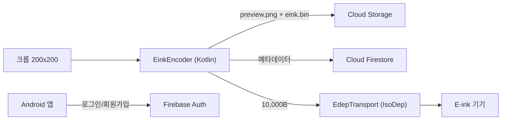

# Firebase 백엔드 설계안 (AWS REST 서버 대체)

## 0. 명세 대비 현재 코드 점검

| 항목 | 명세 | 현재 코드 | 상태 |
|---|---|---|---|
| 크롭 해상도 | 200×200 | [CropScreen.kt:150](file:///Users/iseon-yong/Desktop/프로젝트/digitaltok-compose/app/src/main/java/com/yourcompany/digitaltok/ui/decorate/CropScreen.kt#L150) `cropFromPhotoView(..., 200)` | ✅ 일치 |
| meta 검증 | width/height/bpp/payloadBytes | [ImageViewModel.kt:52](file:///Users/iseon-yong/Desktop/프로젝트/digitaltok-compose/app/src/main/java/com/yourcompany/digitaltok/ui/upload/ImageViewModel.kt#L52) `payloadBytes`만 검사 | ⚠️ 보강 필요 |
| Mock meta 값 | 200×200, 2bpp, 10000B, MSB-first | `ImageRepository` Mock: 250×122, 1bpp, 4000B, LSB | ❌ 구 규격 |
| EDEP/NFC 전송 | 앱 책임 | Compose 앱에는 Mock만 있음 → 레거시 앱에서 프로토콜 확보 ([edep_protocol.md](file:///Users/iseon-yong/.gemini/antigravity-ide/brain/bfe77e13-c280-405b-a177-de650ff645ea/edep_protocol.md)) | 🔧 이식 예정 |

---

## 1. 아키텍처



## 2. ✅ 결정: `.bin` 변환은 앱(Kotlin)에서 처리

Cloud Functions가 필요 없습니다. 서버의 `image/service/processing` 로직을 그대로 이식합니다:

| 서버 (Java) | 앱 (Kotlin) |
|---|---|
| `EinkImagePreprocessor` | 센터 정사각형 크롭 → 200×200 리사이즈 |
| `EinkQuantizer` | 파란색 계열 보정 + 최근접 4색 + Floyd–Steinberg (업로드 이미지) |
| `EinkPreviewRenderer` | 양자화 결과 → preview PNG |
| `EinkBinaryEncoder` | MSB-first 2bpp, **각 행 x=199→0 스캔**, 10,000B 검증 |

원본, preview, bin을 Storage에 함께 올리면 다른 기기에서 다시 전송할 때도 변환 없이 바로 쓸 수 있습니다.

## 3. Firestore 데이터 모델

```
users/{uid}
  email, phone, nickname, createdAt

users/{uid}/devices/{nfcUid}
  nfcUid, name, registeredAt, lastConnectedAt

users/{uid}/images/{imageId}
  imageName, category ("USER_UPLOAD" | "SUBWAY" | "PRIORITY"),
  originalPath, previewPath, einkPath,
  meta { width:200, height:200, bpp:2,
         palette:"Black=0, White=1, Yellow=2, Red=3",
         packing:"MSB-first", scan:"row-major",
         payloadBytes:10000, hasHeader:false },
  isFavorite, createdAt, lastUsedAt

templates_priority/{templateId}    (읽기 전용, seed로 입력)
templates_subway/{templateId}      (읽기 전용, seed로 입력, 검색용 keywords[] 포함)
```

## 4. Storage 경로

```
users/{uid}/images/{imageId}/original.png
users/{uid}/images/{imageId}/preview.png
users/{uid}/images/{imageId}/eink.bin     (정확히 10,000 bytes)
templates/{type}/{templateId}/...
```

## 5. 기존 REST API → Firebase 매핑

| 기존 API | Firebase |
|---|---|
| `auth/signup`, `login`, `logout`, `password/reset` | `FirebaseAuth` |
| `auth/duplicate-check` | 회원가입할 때 `FirebaseAuthUserCollisionException`으로 처리 |
| `users/me` GET/DELETE, `users/email` PATCH | Auth + `users/{uid}` |
| `devices` 등록/조회/삭제 | `users/{uid}/devices/{nfcUid}` |
| `images` 업로드 | Storage 업로드 + `images` 문서 생성 |
| `images/{id}/favorite`, `images/recent` | 문서 update / `orderBy(lastUsedAt desc).limit(n)` |
| `images/{id}/preview`, `binary` | 문서의 `previewPath`, `einkPath`, `meta` 반환 |
| `templates/priority`, `templates/subway` (+search) | 컬렉션 조회 / `array-contains` 검색 |
| `templates/subway/generate` (ADMIN) | Node seed 스크립트로 미리 생성 |

## 6. 보안 규칙 요지

- `users/{uid}/**`: `request.auth.uid == uid`인 경우에만 읽기/쓰기 허용
- `templates_*`: 로그인한 사용자는 읽기만 가능, 쓰기는 불가 (seed는 Admin SDK로 입력)
- Storage `eink.bin`: `request.resource.size == 10000` 강제
- Storage 이미지: 최대 크기 제한, `image/*` 형식만 허용

## 7. 작업 단계

| 단계 | 내용 | 산출물 | 콘솔/계정 필요 |
|---|---|---|---|
| 1 | **E-ink 인코더 + 단위 테스트** | `EinkEncoder.kt`, 패킹/스캔/크기 테스트 | ❌ 바로 가능 |
| 2 | **EDEP NFC 전송** | `EdepTransport.kt`, 미리보기 화면의 Mock 교체 | ❌ 바로 가능 |
| 3 | Firebase 초기 설정 | `firebase.json`, rules, indexes, SDK 연동 | ✅ |
| 4 | Auth 교체 | `AuthRepository` → FirebaseAuth | ✅ |
| 5 | Image/Device 교체 | Storage + Firestore Repository, meta 검증 | ✅ |
| 6 | 템플릿 seed + 조회 | Node seed 스크립트, `TemplateRepository` | ✅ |
| 7 | Emulator 통합 테스트 → 배포 | | ✅ |

1~2단계는 Firebase와 상관없이 바로 시작할 수 있습니다. 둘이 끝나면 **로그인 없이도 사진 → 기기 전송**이 동작합니다.

## 8. 확정된 사항

- **변환 위치**: 앱(Kotlin) ✅
- **EDEP 프로토콜**: 레거시 앱에서 확보 ✅ ([edep_protocol.md](file:///Users/iseon-yong/.gemini/antigravity-ide/brain/bfe77e13-c280-405b-a177-de650ff645ea/edep_protocol.md))
- **디더링**: 업로드 이미지는 Floyd–Steinberg, 지하철 템플릿은 OFF, 파란색 보정 포함 ([server_api_spec.md](file:///Users/iseon-yong/.gemini/antigravity-ide/brain/bfe77e13-c280-405b-a177-de650ff645ea/server_api_spec.md))
- **스캔 방향**: 각 행 오른쪽→왼쪽 (명세 문서가 아닌 서버 코드 기준)
- **`subway/generate`**: Node seed 스크립트 + Pretendard-Bold

## 9. 3단계 전에 콘솔에서 해 주셔야 할 것

1. Authentication → 이메일/비밀번호 로그인 사용 설정
2. Firestore Database 생성 (리전: `asia-northeast3` 서울)
3. Storage 시작 (Blaze 요구 여부 확인)
4. Android 앱 등록(`com.yourcompany.digitaltok`) → `google-services.json`을 `app/`에 추가
5. 터미널에서 `npm i -g firebase-tools && firebase login` 실행
