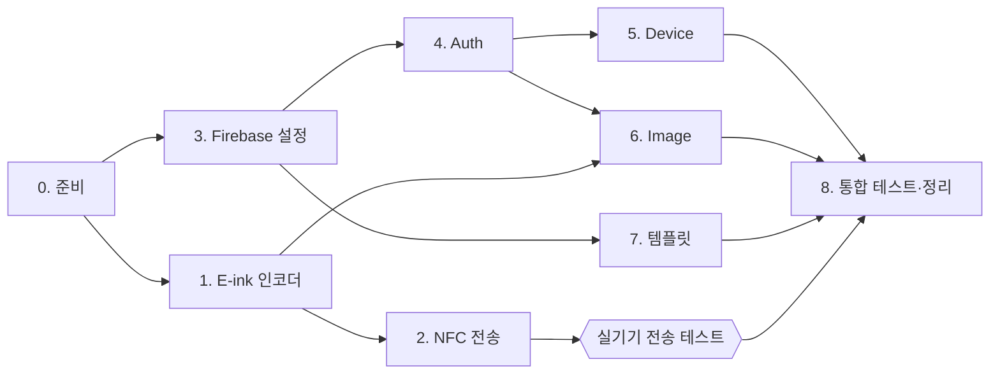

# DigitalTok Firebase 전환 전체 로드맵

## 🎯 프로젝트 목적: 프론트엔드 포트폴리오

> **"팀 프로젝트로 만든 XML 앱을 Compose로 전면 전환했고, 백엔드 서버가 종료되자 남아 있던 코드를 분석해 Firebase로 백엔드를 직접 다시 구축했다."**

제약 조건:
- 기존 AWS 서버 / S3 / DB에 **접근 불가** (다른 팀원이 운영, 현재 종료)
- 남은 자료: 서버 코드, 레거시 앱 코드, `.bin` 명세서

면접에서 어필할 포인트:

| 역량 | 근거 |
|---|---|
| 레거시 분석 | 종료된 Spring 서버 코드에서 API 명세와 변환 규칙 역설계, **명세와 실제 코드의 차이(스캔 방향) 발견** |
| 아키텍처 판단 | 서버에서 하던 이미지 변환을 **클라이언트(Kotlin)로 옮긴 이유**: 비용·속도·단일 인코더 |
| 하드웨어 연동 | ISO-DEP APDU 프로토콜로 E-ink 기기에 전송 |
| 백엔드 역량 | Auth / Firestore 데이터 모델링 / Storage / **Security Rules** / Emulator 테스트 |
| 품질 | 인코더 단위 테스트, Rules 테스트, 단계별 PR |

> 👤 = 직접 하셔야 하는 일 · 🤖 = 제가 할 일 · ⛔ = 다음 단계로 넘어가기 위한 필수 조건 · 📝 = 포트폴리오 산출물

1~2단계(기기 전송)와 3단계(Firebase 설정)는 **동시에 진행할 수 있습니다.** 제가 1~2단계를 작업하는 동안 3단계 콘솔 작업을 해 주시면 됩니다.

---

## Phase 0. 준비 (지금 바로)

| | 할 일 | 비고 |
|---|---|---|
| 👤 | **E-ink 기기 실물 + NFC 되는 안드로이드 폰** 준비 | 에뮬레이터로는 NFC 테스트 불가 |
| 👤 | 아래 「결정 사항」 답변 | |
| 👤 | 작업 브랜치 전략 확인 | 기존 방식대로 `phaseN/...` → `dev` PR이면 그대로 따르겠습니다 |

---

## Phase 1. E-ink 인코더 (Firebase 불필요)

| | 할 일 |
|---|---|
| 🤖 | 서버 Java 로직을 Kotlin `EinkEncoder`로 이식 (크롭·리사이즈 → 파란색 보정 → 4색 + 디더링 → 2bpp 패킹, 행 단위 오른쪽→왼쪽 스캔) |
| 🤖 | 단위 테스트: 결과 10,000B, 패킹 비트 순서, 단색 이미지 기대값, 스캔 방향 |
| 🤖 | 4색 preview 이미지 생성 → 미리보기 화면에 "실제 기기 표시 모습"으로 사용 |
| 👤 | PR 리뷰 및 머지 |

## Phase 2. EDEP NFC 전송 & 미리보기 검증

| | 할 일 |
|---|---|
| 🤖 | `EdepTransport` (SELECT → WRITE×40 → REFRESH → POLL) 프로토콜 로직 완전 구현 |
| 🤖 | `ImagePreviewScreen` / 템플릿 미리보기 연동: 4색 양자화된 **E-ink Preview 비트맵 즉시 렌더링** |
| 🤖 | 기기 미연결 시 가상 완료(시뮬레이션) 또는 NFC 감지 시 실제 전송 시도 모드 지원 |
| 👤 | 📱 **시각적 UI 검증**: 사진을 크롭했을 때 **E-ink 4색(흑/백/황/적) 디더링 미리보기 화면**이 의도대로 선명하고 깨끗하게 렌더링되는지 확인 |

> [!NOTE]
> 실기기가 없더라도, **1) 변환 알고리즘 단위 테스트(10,000 bytes 크기 및 비트 패턴 검증)**와 **2) Compose 화면상 4색 E-ink 미리보기 렌더링**을 통해 변환 정확도를 100% 검증할 수 있습니다. EDEP 전송 코드는 규격대로 완벽히 구현해두어 추후 실기기 태깅 시 즉시 동작하도록 합니다.

---

## Phase 3. Firebase 프로젝트 설정 (👤 위주)

| | 할 일 | 위치 |
|---|---|---|
| 👤 | ⛔ **Authentication** → 시작하기 → 이메일/비밀번호 **사용 설정** | 콘솔 > 보안 > Authentication |
| 👤 | Authentication → 템플릿 → **언어: 한국어** (비밀번호 재설정 메일) | 같은 화면 |
| 👤 | ⛔ **Firestore Database** 만들기 → 위치 `asia-northeast3 (서울)` → **프로덕션 모드** | 콘솔 > 데이터베이스 및 스토리지 |
| 👤 | ⛔ **Storage** 시작 → 같은 리전 | 같은 메뉴 |
| 👤 | (Storage에서 요구하면) **Blaze 요금제** 전환 + **예산 알림 설정**(예: 월 1,000원) | 콘솔 > 사용량 및 결제 |
| 👤 | ⛔ 프로젝트 개요 → Android 앱 추가 → 패키지 `com.yourcompany.digitaltok` → **`google-services.json`을 `app/`에 넣기** | 프로젝트 설정 > 내 앱 |
| 👤 | ⛔ 터미널: `npm i -g firebase-tools` → `firebase login` | |
| 🤖 | Gradle에 Firebase BoM/플러그인 추가, `firebase.json`, `firestore.rules`, `storage.rules`, `firestore.indexes.json` 작성 |
| 🤖 | Emulator Suite 설정 (실제 DB를 건드리지 않고 로컬에서 테스트) |
| 👤 | `firebase deploy --only firestore,storage` 실행 (또는 저에게 실행 요청) |

> [!WARNING]
> `google-services.json`은 공개 레포에 올려도 치명적이지는 않지만, `.gitignore`에 넣을지 결정이 필요합니다. 대신 보안은 **Rules로 지키는 구조**라서 Rules 배포가 필수입니다.

---

## Phase 4. Auth 교체

| | 할 일 |
|---|---|
| 🤖 | 회원가입/로그인/로그아웃/탈퇴/이메일 변경/비밀번호 변경 → `FirebaseAuth` |
| 🤖 | 가입 시 `users/{uid}` 문서 생성 (`nickname = "User_xxxxxxxx"`, 기존 서버와 같은 규칙) |
| 🤖 | 기존 JWT/SharedPreferences 토큰 로직, `RetrofitClient` 인증 인터셉터 제거 |
| 🤖 | 자동 로그인 = `currentUser != null` |
| 👤 | 아래 UX 변경 사항 확인 |

> [!NOTE]
> **UX가 바뀌는 부분**
> - **비밀번호 찾기**: 예전엔 임시 비밀번호를 메일로 보냈지만, Firebase는 **재설정 링크 메일**을 보냅니다. 화면 문구를 "메일을 확인해 주세요"로 바꿔야 합니다.
> - **이메일 중복 확인 버튼**: Firebase 보안 정책상 가입 전 조회가 막혀 있어서, **가입 버튼을 누를 때 중복 에러로 안내**하는 방식으로 바뀝니다.
> - **이메일 변경**: 새 주소로 인증 메일이 가고, 링크를 눌러야 변경이 완료됩니다.

## Phase 5. Device 교체

| | 할 일 |
|---|---|
| 🤖 | NFC UID(`04_A1_...`) → `users/{uid}/devices/{nfcUid}` 등록/조회/해제 |
| 👤 | 실기기 등록 → 앱 재시작 → 연결 상태 유지 확인 |

## Phase 6. Image 교체

| | 할 일 |
|---|---|
| 🤖 | 크롭 → `EinkEncoder` → Storage에 원본/preview/bin 업로드 → Firestore 문서 생성 |
| 🤖 | 최근 이미지, 즐겨찾기, 다시 전송(저장된 bin 사용), meta 검증 강화 |
| 🤖 | Retrofit/OkHttp/Gson 및 Mock Repository 제거 |
| 👤 | 사진 업로드 → 최근 목록 → 즐겨찾기 → 다시 전송 흐름 확인 |

## Phase 7. 템플릿 (교통약자 / 지하철)

| | 할 일 |
|---|---|
| 👤 | ⛔ **교통약자 템플릿 이미지**: 기존 S3에 접근할 수 없으므로 **새로 제작**. 픽토그램 + 문구(예: "임산부입니다")를 지하철 템플릿처럼 **코드로 생성**하는 방식 추천 |
| 👤 | ⛔ **지하철역 목록** 확정: 포트폴리오용이라 대표 역 20~30개면 충분 (제가 초안을 만들 수 있음) |
| 👤 | 서비스 계정 키 다운로드 (콘솔 > 프로젝트 설정 > 서비스 계정) → seed 스크립트 실행용, **레포에 커밋 금지** |
| 🤖 | Node seed 스크립트: 지하철 템플릿 이미지 생성(Pretendard-Bold) → 4색 변환 → Storage/Firestore 업로드 |
| 🤖 | `TemplateRepository`를 Firestore 조회와 검색으로 교체 |

## Phase 8. 통합 테스트 · 정리

| | 할 일 |
|---|---|
| 🤖 | Emulator 기반 Repository 테스트, Rules 테스트 (다른 사용자 데이터 접근 차단) |
| 🤖 | 사용하지 않는 코드와 의존성 정리 |
| 👤 | 전체 시나리오 실기기 QA: 가입 → 기기 등록 → 사진 전송 → 템플릿 전송 → 로그아웃 → 재로그인 → 탈퇴 |
| 👤📝 | **시연 영상** 촬영 (폰으로 사진 선택 → E-ink 화면이 바뀌는 장면) |

---

## 📝 포트폴리오 산출물 (단계별로 함께 작성)

| 산출물 | 내용 | 시점 |
|---|---|---|
| `docs/adr/` | 의사결정 기록 (예: "변환을 클라이언트로 옮긴 이유", "Firestore 컨텍션 구조") | 각 Phase |
| `docs/troubleshooting/` | 문제 → 원인 → 해결 (예: 명세와 다른 스캔 방향, 실기기에서 생긴 문제) | 문제가 생길 때마다 |
| `docs/legacy-analysis.md` | 기존 서버 분석 결과 (API 25개 역설계, AWS → Firebase 매핑표) | Phase 0 |
| `docs/edep-protocol.md` | NFC 프로토콜 문서 | Phase 2 |
| README | Before/After 아키텍처 다이어그램, 기술 스택, 시연 GIF | Phase 8 |

> [!TIP]
> 지금까지 만든 [server_api_spec.md](file:///Users/iseon-yong/.gemini/antigravity-ide/brain/bfe77e13-c280-405b-a177-de650ff645ea/server_api_spec.md)와 [edep_protocol.md](file:///Users/iseon-yong/.gemini/antigravity-ide/brain/bfe77e13-c280-405b-a177-de650ff645ea/edep_protocol.md)는 그대로 `docs/`에 옮겨 포트폴리오 문서로 쓸 수 있습니다.

---

## ❓ 결정 사항 (Phase 0에서 답변 필요)

| # | 질문 | 상태 |
|---|---|---|
| 1 | 기존 AWS 사용자 데이터 이전 | ✅ **새로 시작** (접근 불가) |
| 2 | 비밀번호 찾기를 재설정 링크 방식으로 | 답변 필요 (추천: 링크) |
| 3 | 이메일 중복 확인 버튼 제거 | 답변 필요 (추천: 가입할 때 에러로 안내) |
| 4 | `google-services.json` 커밋 여부 | 답변 필요 (포트폴리오 공개 레포면 Rules로 보호하므로 커밋해도 됨) |
| 5 | 테스트 기기 확보 여부 | 답변 필요 |
| 6 | 템플릿 이미지 | ✅ **새로 제작** (코드 생성 추천) |

## 요약: 직접 하실 일 체크리스트

- [ ] 결정 사항 1~6 답변
- [ ] 실기기 + NFC 폰 준비
- [ ] Firebase 콘솔: Auth(이메일) / Firestore(서울) / Storage / Android 앱 등록
- [ ] `google-services.json` → `app/`
- [ ] `firebase-tools` 설치 + `firebase login`
- [ ] (필요 시) Blaze 전환 + 예산 알림
- [ ] Phase 2 실기기 전송 테스트
- [ ] 교통약자 템플릿 문구 + 지하철역 목록 확정 (초안은 제가 작성)
- [ ] 서비스 계정 키 다운로드 (로컬에만 보관)
- [ ] 단계별 PR 리뷰 및 최종 QA
- [ ] 시연 영상 촬영
